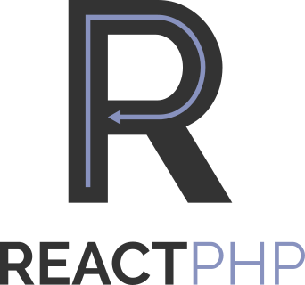
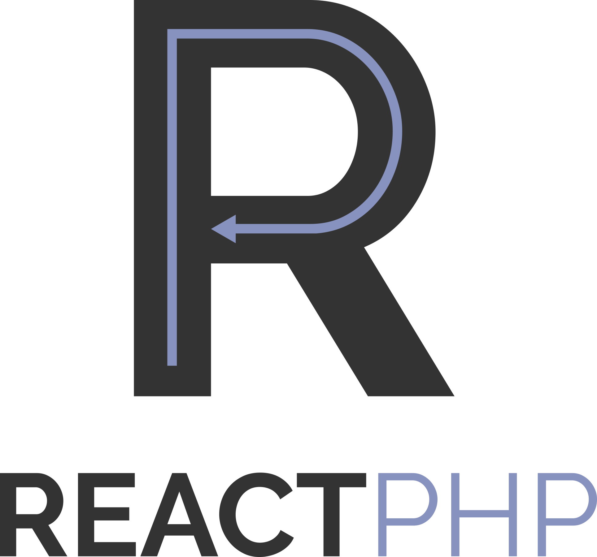

Branding
========

Project brand assets and guidelines for ReactPHP.

Logo
----

| Name   | SVG                                                                                              | PNG                                                                                              |
|:-------|:------------------------------------------------------------------------------------------------:|:------------------------------------------------------------------------------------------------:|
| Logo   |        |        |
| Symbol |  |  |
| Type   |        |        |
| Icon   |        |        |

Color Palette
-------------

| Name             | HEX       | RGB           | Sample                     |
|:-----------------|:----------|:--------------|:---------------------------|
| Key Color        | `#4f5b93` | `79, 91, 147` |   |
| Base Color       | `#584b4f` | `88, 75, 79`  |  |

Naming
------

* Project name: **ReactPHP**
* Slogan: **Event-driven, non-blocking I/O with PHP.**
* Hashtag for project related content: `#reactphp`

Credits
-------

* Logo type font: [Viga](https://fonts.google.com/specimen/Viga)
* The license has been inspired by the [webpack media license](https://github.com/webpack/media/blob/37b4686e9e6b4725813167e9e5605464870d0ecb/LICENSE)

License
-------

Copyright (c) 2017 by the ReactPHP project.

The logo and the brand name **are not MIT licensed**. Please check [our LICENSE](LICENSE) for usage guidelines.
